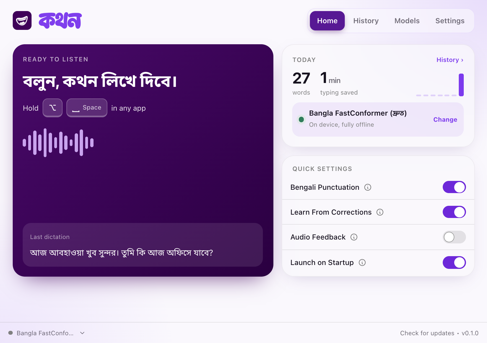
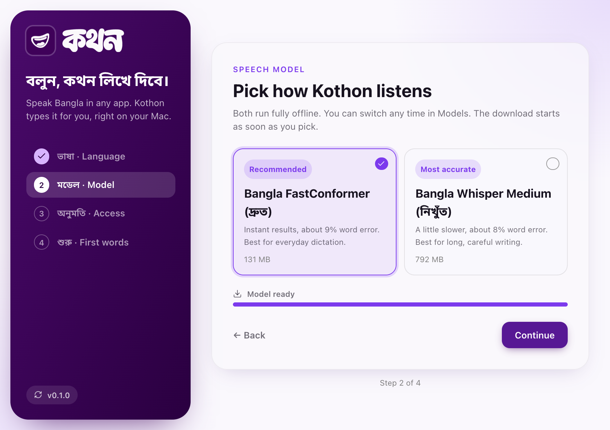
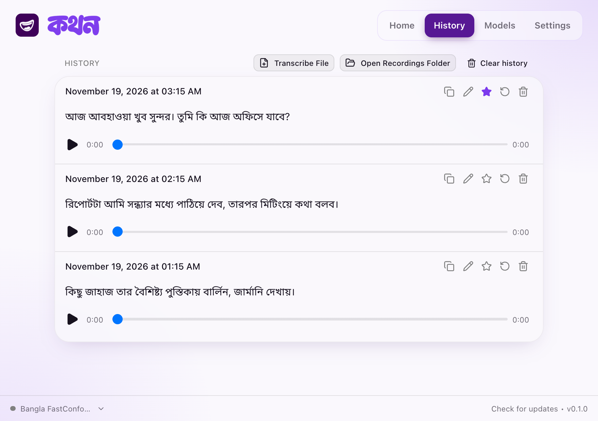

<p align="center">
  
</p>

<h1 align="center">কথন · Kothon</h1>

<p align="center">
  <b>Offline Bengali dictation for macOS.</b><br/>
  বাংলায় বলুন, যেকোনো অ্যাপে। Hold a shortcut, speak Bangla, and Kothon types it wherever your cursor is.
</p>

<p align="center">
  <a href="https://huggingface.co/omnixima">Models on Hugging Face</a> ·
  <a href="#install">Install</a> ·
  <a href="#build-from-source">Build from source</a>
</p>

> [!WARNING]
> **Early access.** Kothon is new and still in active development, so expect rough edges and the occasional bug. Please [report anything that breaks](https://github.com/Omnixima/kothon/issues/new/choose). It helps a lot.

<p align="center">
  <picture>
    <source media="(prefers-color-scheme: dark)" srcset="docs/images/01-home-dark.png" />
    
  </picture>
</p>

## Why Kothon

Most dictation tools treat Bengali as an afterthought. General-purpose Whisper models get about half the words wrong. Kothon is built around Bengali from the ground up, and everything runs on your Mac:

- **Accurate Bengali speech recognition.** Two tuned models, chosen after testing on the FLEURS Bengali benchmark:
  - **Bangla FastConformer** (fast): about 9% word error, around 0.04 s for a sentence on Apple Silicon.
  - **BengaliAI Whisper Medium** (accurate): about 8% word error.
- **Real punctuation.** দাঁড়ি, commas and question marks are added on device, in about 16 ms.
- **Numbers written properly.** দুই হাজার পঁচিশ becomes ২০২৫, পঞ্চাশ শতাংশ becomes ৫০%. You can choose Bengali or Latin digits.
- **Learns from your fixes.** Correct a word in History once, and Kothon gets it right next time.
- **Banglish when you want it.** English words you use mid-sentence can be written in English: মিটিংয়ে → meeting-এ.
- **Automatic English.** Dictate a whole sentence in English and Kothon switches to an English model on its own.
- **Private by design.** No cloud, no account, no telemetry. Turn history off entirely, or clear it any time.

<p align="center">
  <picture>
    <source media="(prefers-color-scheme: dark)" srcset="docs/images/08-onboarding-model-dark.png" />
    
  </picture>
  <picture>
    <source media="(prefers-color-scheme: dark)" srcset="docs/images/02-history-dark.png" />
    
  </picture>
</p>

## Install

Download the latest signed, notarized `.dmg` from [Releases](https://github.com/Omnixima/kothon/releases), drag Kothon to Applications, and open it. The setup wizard does the rest:

1. Choose your languages. Bengali is always on, and you can add English.
2. Pick a model. It downloads once from [huggingface.co/omnixima](https://huggingface.co/omnixima).
3. Allow the microphone and Accessibility.
4. Hold the shortcut (<kbd>⌥</kbd> <kbd>Space</kbd> by default) and speak.

You'll need macOS on Apple Silicon. Intel Macs work too, but run on the CPU only.

## Models

| Model                                                                                               | Size   | Bengali WER                     | Source                                         |
| --------------------------------------------------------------------------------------------------- | ------ | ------------------------------- | ---------------------------------------------- |
| [Bangla FastConformer CTC 116M](https://huggingface.co/omnixima/bangla-fastconformer-ctc-116m-gguf) | 138 MB | 9.0%                            | kazalbrur, Apache-2.0                          |
| [BengaliAI Whisper Medium](https://huggingface.co/omnixima/bengaliai-whisper-medium-gguf)           | 831 MB | 8.2% (7.1% with number cleanup) | Erdene-Ochir Tuguldur / Bengali.AI, Apache-2.0 |
| [Bangla punctuation (MuRIL)](https://huggingface.co/omnixima/bangla-punctuation-muril6)             | 122 MB | n/a                             | Tuguldur, packaged by SayedShaun, Apache-2.0   |

WER was measured on 200 FLEURS bn_in test clips with punctuation removed. All models run through [transcribe.cpp](https://github.com/handy-computer/transcribe.cpp) (GGUF, Metal).

## Build from source

You'll need Rust, [Bun](https://bun.sh), Xcode Command Line Tools and CMake.

```bash
git clone https://github.com/Omnixima/kothon.git
cd kothon
bun install
mkdir -p src-tauri/resources/models
curl -L -o src-tauri/resources/models/silero-vad-v6.2-F32.gguf \
  https://huggingface.co/handy-computer/silero-vad-v6.2-gguf/resolve/main/silero-vad-v6.2-F32.gguf
CMAKE_POLICY_VERSION_MINIMUM=3.5 bun run tauri dev
```

To make a release build, run `bun run tauri build`. See [BUILD.md](BUILD.md) for details.

Useful scripts:

- `scripts/kothon/make-icons.sh` regenerates every app and menu bar icon from the design files.
- `src-tauri/examples/kothon_bench.rs` times the Bengali models through the app's engine.
- `dev-preview/` renders the interface in a browser with a simulated backend, for design work.

## Troubleshooting

- **The shortcut stopped working.** Another app may have turned on macOS Secure Input (password managers and some terminals do). Kothon shows a warning when this happens. Close or unfocus that app's password field.
- **Nothing gets typed.** Check System Settings › Privacy & Security › Accessibility and make sure Kothon is on. After reinstalling, toggle it off and on again.
- **A word keeps coming out wrong.** Fix it once in History (the pencil icon). Kothon learns the correction.

## Privacy

Audio is captured only while you hold or toggle the shortcut. It's transcribed on your Mac and never uploaded. Kothon only goes online to download the models you choose. History is stored locally, and you can switch it off or clear it in Settings.

## Credits

Kothon is built on [Handy](https://github.com/cjpais/Handy) by CJ Pais (MIT), and its speech engine is [transcribe.cpp](https://github.com/handy-computer/transcribe.cpp) and [ggml](https://github.com/ggml-org/ggml). The Bengali models come from the [Bengali.AI](https://bengali.ai) community: Erdene-Ochir Tuguldur's first-place solution to the Bengali.AI Speech Recognition competition, kazalbrur's FastConformer, and SayedShaun's punctuation packaging.

## License

MIT. See [LICENSE](LICENSE).
